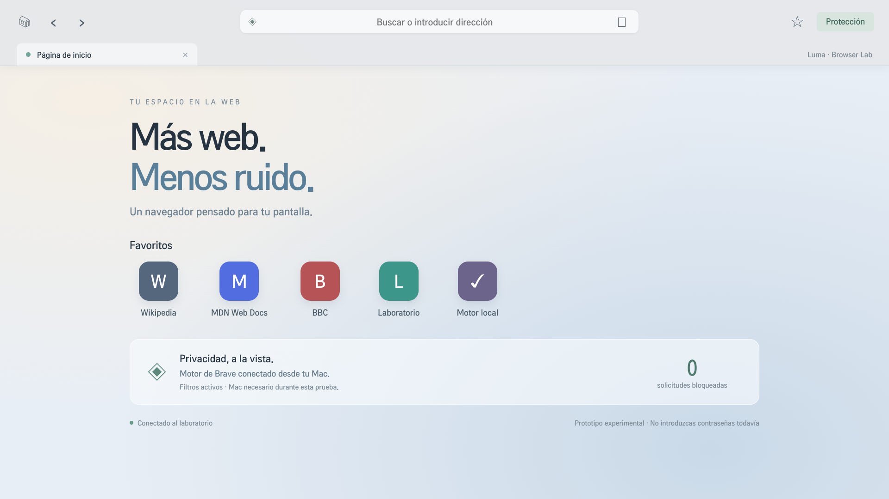

# Holy · LG webOS

App de películas, anime, doramas y series con interfaz tipo Netflix para la LG 75UR8750PSA (`com.lgapp.holy`). Usa el motor de Luma Browser Lab (puente del Mac, bloqueo de Brave, escudos) y abre directamente el reproductor de cada sitio. Estado y comandos en [docs/SOUL.md](docs/SOUL.md); informe en [docs/HOLY.md](docs/HOLY.md).

```sh
npm run holy      # en el Mac: inicio, catálogo y puente (espera a que abras Holy en la TV)
npm test
npm run package   # IPK en artifacts/
```

---

# Luma Browser Lab · LG webOS

Prototipo Svelte con interfaz inspirada en Safari y motor de bloqueo de Brave. Instalado como `com.lgapp.lab`, versión 0.6.0, en LG 75UR8750PSA. Trabajo del 21 de octubre de 2026.

**El motor real funciona en la TV. La navegación pública con interceptación de red funciona actualmente con ayuda del Mac.** El modo local de prefiltrado está limitado a HTML propio de laboratorio.

## Interfaz, velocidad y YouTube · 0.6.0

- **Interfaz minimalista estilo Safari.** Inicio con saludo, buscador central, favoritos e informe de privacidad (logo del león). Configuración en grupos tipo iOS. El control remoto se mueve en 2D hacia el elemento más cercano; el foco eleva la tarjeta con animaciones suaves que respetan «reducir movimiento».
- **Barra de páginas compacta.** Muestra el dominio con candado y el progreso dentro de la dirección; ya no tapa la página mientras carga. Se oculta sola al leer y vuelve al subir, con ▲ arriba del todo, con el puntero en el borde superior o con las teclas de color. OK sobre la dirección permite escribir. ★ guarda la página en Favoritos (se guardan en el Mac).
- **Más rápido.** La caché HTTP vuelve a estar activa y DevTools no guarda los cuerpos de las respuestas. En la TV, la visita repetida mediana pasó de 2192 a 1329 ms y de 403 a 86 KB de red (3 sitios, una pasada; `evidence/performance/`).
- **YouTube.** Escudo propio: elimina los datos de anuncios del reproductor y del feed, oculta bloques publicitarios y salta anuncios residuales. En la TV, el mismo vídeo empezó en 0 s sin anuncios con protección y mostró dos anuncios (~12 s) sin ella (`evidence/youtube/`). YouTube cambia sus métodos: no hay garantía de cero anuncios.
- **Filtros desde el principio.** CSS y scriptlets se registran antes de que exista el documento (YouTube siempre; direcciones escritas, favoritos y el resto de enlaces de un sitio ya visitado). Los anuncios que aparecen después se ocultan con selectores calculados por el motor de Brave en el Mac.

Pruebas locales: `npm test`. En la TV (un solo interceptor a la vez): `validate-settings`, `validate-navigation`, `validate-youtube`, `benchmark` y `validate:browser`. Los filtros siguen a Brave automáticamente: mismas listas, mismo espejo y mismos scriptlets, con una comprobación cada 30 minutos mientras corre `npm run lab` (`npm run lists:update` la fuerza; `npm run lists:rollback` vuelve a la versión anterior). Detalle en [docs/BRAVE-ACTUALIZACIONES.md](docs/BRAVE-ACTUALIZACIONES.md).

## Configuración de buscador · 0.5.0

Google es el buscador predeterminado. El botón **Configuración** de inicio y **Config.** en las páginas permite elegir Google, Bing, DuckDuckGo o Brave Search. La elección se aplica a las dos barras; no hay cambio automático de proveedor si un sitio devuelve un error.

La preferencia se guarda en `.local/browser-settings.json` en el Mac y se refleja en el almacenamiento local de la app. Se conserva al recargar, volver a abrir la app y reiniciar el puente. El Mac sigue siendo necesario para la navegación asistida. La selección de buscador no cambia los filtros de Brave.

Verificación: `node scripts/test-navigation.mjs` y `node scripts/validate-settings.mjs http://127.0.0.1:PUERTO` (sin otro puente activo). Evidencias en `evidence/search-settings/`.

## Corrección de navegación 0.4.0

La barra de inicio y la barra de páginas comparten el mismo resolver de búsquedas y URLs. Se detectó un HTTP 429 de Brave Search durante una búsqueda real; el buscador predeterminado pasó a DuckDuckGo HTML. El motor de bloqueo continúa siendo Brave.

Se añadieron indicador animado de carga, progreso, transiciones de botones y favoritos, soporte de movimiento reducido y estados visibles de error con Reintentar e Inicio. Las hojas de estilo de la barra y los filtros cosméticos se aplican con CSSOM para funcionar también en páginas con CSP restrictiva, sin retirar cabeceras del sitio. El iniciador detecta si la TV reemplaza la instancia de la app y vuelve a conectar.

Las evidencias de esta corrección se guardan en `evidence/navigation-fix/`. Las pruebas se ejecutan con `node scripts/test-navigation.mjs` y, sin otro puente activo, `node scripts/validate-navigation.mjs http://127.0.0.1:PUERTO`.

## Resultados

- Motor Brave `adblock-rust` 0.13.3, compilado a WASM y ejecutado en la TV: 5/5 comprobaciones de reglas correctas; aproximadamente 2.7 s de inicialización y 46.4 MiB de memoria WASM con 141,878 líneas de listas.
- Prefiltrado local: 7/7 solicitudes publicitarias controladas impedidas y 8/8 legítimas preservadas. No demuestra compatibilidad con todos los sitios.
- Modo asistido por Mac: misma cuenta de fixtures, CSS y scriptlet temprano correctos; navegación real verificada en Example Domain, MDN y BBC.
- Motor Node: 15/15 pruebas de reglas, excepciones, tipos, reemplazos, parámetros, selectores y scriptlets.
- UI de TV: barra de direcciones, favoritos, navegación y estado de protección; captura a 1920 × 1080.

No hay un porcentaje defendible de “Brave completo replicado” o “anuncios de Internet eliminados”. Las cifras anteriores tienen denominadores concretos en pruebas controladas. DNS queda para el final; no se modificó.

## Documentación y evidencias

- [Semilla: estado actual y guía para continuar](docs/SEMILLA.md)
- [Plan para trabajar más rápido y con mayor seguridad](docs/PLAN-MEJORAS.md)
- [Informe de validación y límites](docs/BROWSER-VALIDATION.md)
- [Análisis del código de Brave y adaptación](research/BRAVE-ANALYSIS.md)
- [Inventario de la primera sesión](docs/INITIAL-INVENTORY.md)
- [Evidencias JSON y capturas](evidence/browser-lab/)
- [Procedencia y huellas de fuentes/binarios](research/provenance.json)



## Ejecutar

Node 22.22.3 y npm 10.9.8 en macOS arm64. CLI LG instalada localmente. El lock fija versiones. La compilación WASM requiere Rust y el target `wasm32-unknown-unknown`; el binario preparado está incluido en `public/adblock.wasm`.

```sh
npm ci
npm run dev
npm run package
```

Para reconstruir el motor WASM desde el adaptador y el crate fijado:

```sh
rustup target add wasm32-unknown-unknown
npm run build:native
npm run package
```

La configuración actual utiliza TV `192.168.1.134` y Mac `192.168.1.148`. Confirmar ambas IP y la sesión de Developer Mode antes de conectar. Los fixtures y el botón de validación local contienen la IP actual del Mac; si cambia, actualizar también esas referencias y reempaquetar.

```sh
npm run tv:info
npx --no-install ares-install --device lg-lab artifacts/com.lgapp.lab_0.6.0_all.ipk
npm run tv:launch
```

Si cambia la IP de la TV, actualizar el perfil `lg-lab` con `ares-setup-device`. La llave de desarrollo está fuera del repositorio en `~/.ssh/lg-lab_webos`. No guardar llaves ni passphrases aquí.

## Navegación asistida con el Mac

Mantener el servidor y la conexión pasiva en terminales separadas:

```sh
npm run lab:server
# En otra terminal:
npm run lab
```

Desde la corrección del 2026-10-23, `npm run lab` solo abre un túnel SSH local y espera a que el usuario abra Luma. No ejecuta `ares-inspect`, no lanza aplicaciones, no trae Luma al frente ni navega automáticamente al inicio. Si se apaga la TV o se cierra Luma, espera sin abrirla. Una exclusión por PID evita dos procesos del laboratorio en esta carpeta.

El puerto del inspector cambia entre sesiones. El servidor local utiliza 43187 y 43188; solo acepta conexiones del Mac y la IP configurada de la TV. No se instaló inicio automático.

El Mac evalúa reglas y comunica decisiones por el inspector; **las páginas se renderizan en la TV**, no es transmisión de un navegador del Mac. Al cerrar el puente, la protección de red asistida deja de funcionar. El número mostrado es de solicitudes bloqueadas durante la conexión actual.

El modo sigue siendo experimental. La barra superpuesta no tiene las garantías de aislamiento de una barra nativa de navegador, y todavía no se validaron contraseñas, sesiones, DRM ni pagos. Las pruebas usaron páginas públicas sin iniciar sesión.

## Repetir las pruebas

No ejecutar dos interceptores o dos validaciones que naveguen la TV simultáneamente. Detener primero `npm run lab` o `lab:bridge`. Mantener el servidor; abrir Luma manualmente y ejecutar `node scripts/passive-inspect.mjs` para obtener un endpoint actual sin lanzar aplicaciones.

```sh
npm run validate:engine
npm run validate:native -- http://127.0.0.1:PUERTO
npm run validate:browser -- http://127.0.0.1:PUERTO
npm run verify:tv -- http://127.0.0.1:PUERTO
```

Para `validate:native`, lanzar la app empaquetada desde su inicio y después abrir el inspector. Esa prueba usa CDP para observar, con interceptación deshabilitada. La prueba pública necesita el interceptor y lo detiene al terminar. Los resultados se escriben en `evidence/browser-lab/`.

El botón **Motor local** permite ejecutar desde la TV la validación WASM y el hook tardío de la página controlada; el prefiltrado completo adicional se ejecuta con `validate:native`. Ambos requieren que el servidor de fixtures esté disponible, pero sus decisiones de filtrado se calculan en la TV.

Tras cerrar y relanzar la app puede cambiar el target del inspector. Si cae el túnel de pruebas, volver a ejecutar `scripts/passive-inspect.mjs`. Al terminar, cerrar ese túnel y restaurar `npm run lab`. El comando histórico `scripts/verify-tv.mjs` corresponde a la primera app; `npm run verify:tv` apunta al verificador actual.

## Alcance de seguridad y recursos

No se escribió firmware, no se modificaron particiones ni arranque y no se obtuvo root. El inventario no es un respaldo recuperable del firmware.

El acceso amplio que permite la app empaquetada a los fixtures no se habilitó como navegación arbitraria en iframes. Los experimentos locales están restringidos a HTML propio para no confundir un resultado de filtrado con un navegador aislado y seguro.

Las dependencias de herramientas de desarrollo conservan avisos npm, incluidos avisos en la CLI oficial. El reporte original está en las evidencias de inventario. Las dependencias Node, la CLI y el servidor no se empaquetan en la app; sí se incluye WASM, listas y sus avisos de licencia.

Licencias: motor Brave MPL-2.0, adaptador WASM local MPL-2.0, Svelte MIT; EasyList/EasyPrivacy conservan cabeceras y referencias de licencia. Ver `public/THIRD_PARTY.txt`.


## Cuevana y reproductores · 0.7.2

[Informe y límites de las pruebas](docs/CUEVANA-VALIDATION.md). Se corrigieron ventanas, salidas automáticas, cargadores publicitarios y el primer clic del servidor probado. El recorrido ligero abre el reproductor del sitio en esta pestaña. En TV: Omaha, Bad Apples y Solomamma (Hyper) iniciaron con el botón real, reprodujeron y permitieron avanzar al minuto uno. Son muestras cortas; no acredita todo el catálogo ni todos los servidores. El Mac sigue siendo necesario.


Corrección de apertura involuntaria (2026-10-23): ver `docs/PASSIVE-CONNECTION-FIX.md`. No volver a usar el antiguo bucle de `ares-inspect`, porque su implementación puede lanzar la app si no está ejecutándose.

QR dinámico de JKAnime (2026-10-23): origen, reglas y pruebas en `docs/JKANIME-VALIDATION.md`. Para repetir solo esa validación: `node scripts/validate-jkanime.mjs ENDPOINT` con el laboratorio habitual detenido.

## Pestañas · 0.8.0 preparada

[Pestañas superiores, uso y límites](docs/TABS.md). Permiten abrir, cambiar y cerrar hasta doce páginas, con historial independiente. Son pestañas suspendidas: se recargan al seleccionarlas y los vídeos no siguen en segundo plano. El diagnóstico «Sin Mac» y el contador superior solo aparecen con `LUMA_DEBUG=1 npm run lab`. El paquete 0.8.0 está preparado; instalación y comprobación en TV pendientes de disponibilidad, con otra prueba activa en la misma TV.
