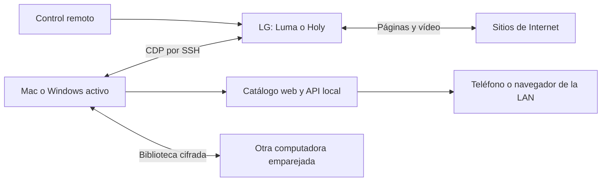

# Luma y Holy · LG webOS

**Código y Holy 0.9.31 · documentación revisada el 8 de noviembre de 2026.** Esta revisión incluye trabajo local aún sin publicar; comprueba la versión al clonar el remoto.

Dos apps de TV con un servicio compartido en Mac o Windows:

- **Luma** (`com.lgapp.lab`): navegador, buscador, marcadores y barra de páginas.
- **Holy** (`com.lgapp.holy`): catálogo, búsqueda, episodios, idiomas, reproducción asistida y gustos.
- **Servicio de computadora**: motor de filtrado de Brave (`adblock-rs`), conexión con la TV, catálogo, biblioteca y sincronización entre equipos.
- **Holy web**: catálogo desde un navegador de la misma red; **Holy Companion** es opcional para el progreso de vídeos externos.

Las páginas y los vídeos se reproducen en la TV. La computadora asiste mediante CDP dentro de SSH; no transmite su pantalla ni actúa como proxy general del vídeo. Sin computadora, Luma pierde el filtrado de red asistido; Holy necesita el servicio. No es Brave completo ni garantiza eliminar toda publicidad.



## Guías

| Necesitas | Documento |
| --- | --- |
| Instalar en Mac/Windows y vincular la TV | [Instalación y operación](docs/INSTALACION.md) |
| Entender arranque, filtrado, reproducción y datos | [Arquitectura y diagramas](docs/ARQUITECTURA.md) |
| Ver correcciones aplicadas y límites restantes | [Endurecimiento 0.9.30](docs/ENDURECIMIENTO-20261107.md) |
| Ver hallazgos, riesgos y plan de corrección | [Revisión de calidad y seguridad](docs/REVISION-CALIDAD-SEGURIDAD-20261107.md) |
| Consultar qué está probado y qué falta | [SOUL: estado vivo del proyecto](docs/SOUL.md) |
| Usar Servidor en pausa y el botón amarillo | [Servidor y Mi cola](docs/SERVIDORES-COLA-20261107.md) |
| Consultar instalación y pruebas de la versión actual en LG | [Despliegue 08/11](docs/DESPLIEGUE-TV-20261108.md) |
| Entender el gate y las pruebas físicas | [Protocolo de reproducción](docs/PROTOCOLO-REPRODUCCION.md) |
| Consultar pruebas antiguas | [README histórico](docs/README-HISTORICO.md) |

## Empezar

Requiere Git, Node/npm, una computadora y una LG con Developer Mode. Usa Node 24 mantenido para alinearte con CI; no copies dependencias entre sistemas ni omitas las de desarrollo: el servicio utiliza parte de ellas.

En Mac, desde una copia nueva del proyecto:

```sh
npm ci
npm run playback:check
```

En Windows, abre PowerShell normal desde el escritorio, en la carpeta del proyecto:

```powershell
powershell.exe -NoProfile -ExecutionPolicy Bypass -File .\windows\Preparar.ps1
```

El preparador Windows ya instala dependencias, compila e instala el control. Continúa con [la guía de vinculación e IPK](docs/INSTALACION.md#4-vincular-cada-computadora-con-la-tv). Generar una interfaz no la instala en la TV. Usa la IP actual y conserva las llaves fuera del repositorio.

Después de vincular:

```sh
npm run desktop:start
npm run desktop:status
npm run desktop:doctor
```

Abre Holy o Luma manualmente en la TV. Un equipo en `standby` está en respaldo, no necesariamente tiene un error. No ejecutes el laboratorio antiguo y el servicio común al mismo tiempo.

## Estado y límites

El gate local de esta revisión pasó: sintaxis de **191 archivos JS/MJS**, suite, **42 casos documentados / 11 contratos de fuentes** y tres builds. Las cifras son pruebas controladas, no cobertura general de Internet. Holy 0.9.31 está instalado en LG y el backend actualizado está en Mac; Windows sigue pendiente. Resultados y límites de la prueba en [el informe de despliegue](docs/DESPLIEGUE-TV-20261108.md). La cola es local a cada computadora; los gustos, idiomas e historial/progreso sí tienen sincronización.

0.9.30 refuerza descargas/redirecciones, limita memoria/concurrencia, fija la identidad SSH después de la primera autenticación y corrige errores HTTP y de cola. Sigue pendiente autenticar de forma general a los clientes de la LAN; SSH mantiene la limitación de confianza del primer contacto. `npm audit --package-lock-only` reportó 10 paquetes con alertas, incluida una crítica transitiva de herramientas LG; no se demostró su explotación en el servicio habitual. Consulta [el informe](docs/REVISION-CALIDAD-SEGURIDAD-20261107.md) antes de ampliar acceso. El servicio está pensado para una red local de confianza, sin publicar puertos en Internet.

## Desarrollo

```sh
npm run dev               # Interfaz de desarrollo en loopback
npm run build:all         # Luma + Holy TV + Holy web
npm run playback:check    # Suite completa y tres builds, sin navegar TV
npm run package:holy      # Gate, build e IPK Holy
npm run package           # Gate, build e IPK Luma
npm run desktop:log -- 7  # Registro reciente de conexión
npm run holy:errors       # Informe de reproducción
```

Para trabajar en el repositorio, lee primero `docs/SOUL.md`, revisa los cambios locales y actualiza ese resumen al terminar. No modifiques firmware, arranque, particiones ni DNS. Una sola prueba que navegue la TV a la vez; fuera de una sesión en uso y restaurando sesión/buscador al terminar.

Licencias de las fuentes de referencia: [motor Brave](research/brave/LICENSE) y [recursos](research/brave/resources-LICENSE). Las evidencias históricas conservan su propio alcance y no deben presentarse como validación de la versión actual.
