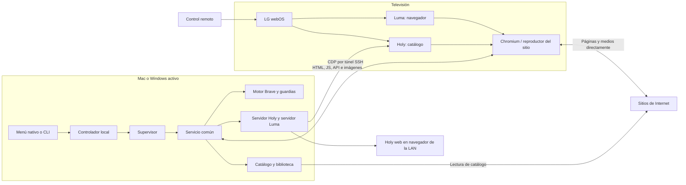
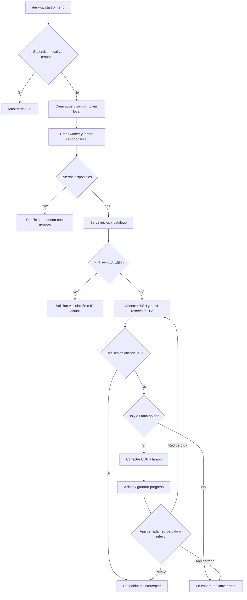
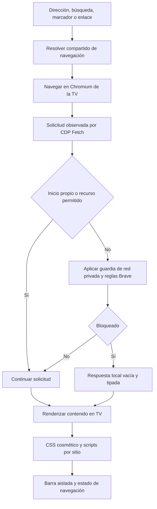
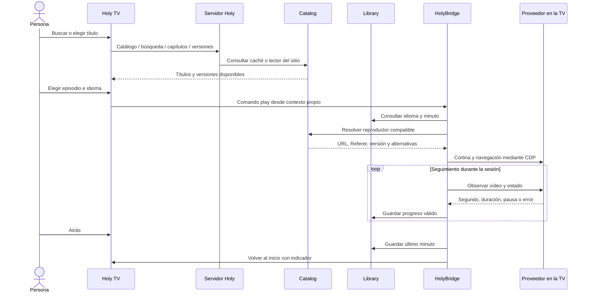
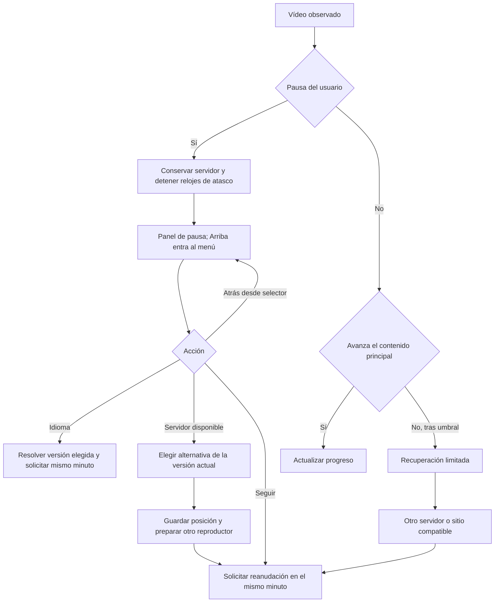
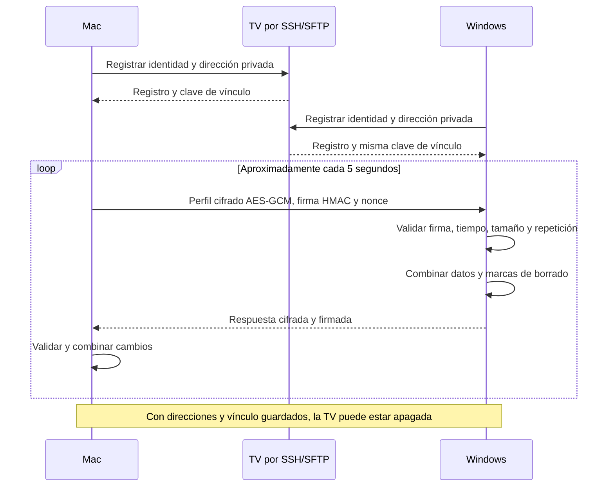
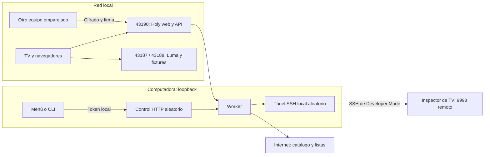

# Cómo funciona Luma / Holy

Revisión **2026-11-08 · código 0.9.31**. Los diagramas representan el código actual; no significan que todas las rutas se hayan comprobado en la TV. [Instalación](INSTALACION.md) · [Auditoría](REVISION-CALIDAD-SEGURIDAD-20261107.md) · [Estado vivo](SOUL.md) · [Prueba LG 08/11](DESPLIEGUE-TV-20261108.md).

## 1. Vista general

Luma es la interfaz de navegador; Holy es una app de catálogo independiente que reutiliza el mismo motor de conexión y filtrado. Las páginas y los vídeos se renderizan en la TV. La computadora toma decisiones de filtrado y prepara la reproducción mediante el protocolo de depuración de Chromium (CDP), dentro de un túnel SSH de Developer Mode. No transmite una pantalla de navegador desde la computadora ni sirve como proxy de los archivos de vídeo.

Sin computadora, Luma puede abrir páginas, pero no conserva el filtrado de red asistido de esta arquitectura. Holy necesita el servicio para catálogo y reproducción asistida. El experimento WASM local y sus fixtures no equivalen a un navegador Brave autónomo.

## 2. Módulos y responsabilidades

| Módulo | Responsabilidad |
| --- | --- |
| `src/App.svelte`, `navigation.js`, `spatial.js` | Inicio Luma, resolver de direcciones y foco del control |
| `src/Holy.svelte`, `holy.js`, `holy-curation.js` | Interfaz TV de catálogo, filas, categorías, idiomas y cola |
| `src/HolyWeb.svelte` | Catálogo para navegador normal; reproducción con límites de Referer |
| `desktop/shared/desktop-control.mjs` | Acciones del usuario y consulta del servicio |
| `desktop-supervisor.mjs`, `desktop-host.mjs` | Un supervisor con un worker; ciclo de vida, servicios HTTP, recuperación |
| `scripts/ssh-host-trust.mjs` | Identidad SSH por perfil; primera autenticación y rechazo de cambios posteriores |
| `scripts/lab-runtime.mjs`, `inspector-tunnel.mjs`, `tv-lease.mjs` | Descubrir apps abiertas, túnel, exclusión y relevo |
| `scripts/cdp.mjs`, `browser-bridge.mjs` | Transporte CDP y comandos de navegador |
| `scripts/filter-engine.mjs`, `shields.mjs`, `navigation-shield.mjs` | Evaluación de reglas y guardias de navegación |
| `scripts/toolbar.mjs`, `ad-cleaner.mjs` | Barra superpuesta y limpieza reversible |
| `scripts/holy/public-fetch.mjs` | Descargas públicas con DNS comprobado por la conexión, redirecciones, límite de bytes y concurrencia |
| `scripts/holy/catalog.mjs`, `connectors.mjs`, `sources.mjs`, `more-sources.mjs`, `youtube.mjs` | Lectores de sitios, caché, búsqueda y resolución de reproductores |
| `scripts/holy/holy-bridge.mjs`, `page-scripts.mjs`, `player-safety.mjs` | Sesión de vídeo, cortina, pausa, cambio de versión/servidor y recuperación |
| `scripts/holy/library.mjs`, `taste-state.mjs` | Vistos, progreso, votos, preferencias, idiomas y cola local |
| `desktop/shared/profile-state.mjs`, `tv-profile-store.mjs` | Perfil compartido temporal por SSH/SFTP |
| `desktop/shared/peer-sync.mjs`, `sync-protocol.mjs`, `peer-registry.mjs` | Descubrimiento por TV e intercambio directo cifrado entre equipos |
| `scripts/holy/server.mjs`, `web-playback.mjs`, `browser/holy-companion/` | API LAN, sesiones de progreso web y complemento opcional |
| `scripts/diagnostics.mjs`, `holy/playback-log.mjs`, `desktop/shared/*repair*.mjs` | Registro, explicación de fallos y reparación limitada |

Hay once conectores declarados; YouTube participa solo en búsquedas. El antiguo catálogo público `tmdb` está retirado. Una dirección nueva en «Webs» no crea automáticamente un lector: necesita implementación compatible.

## 3. Arranque, espera y relevo

El candado del proyecto evita dos runtimes locales. La reserva temporal de la TV arbitra computadoras distintas; vive en `/tmp/luma-desktop-assist`. Se renueva aproximadamente cada 5 segundos, vence en unos 60 segundos y hay un vigilante local más corto para no actuar con una reserva vencida. El túnel elige un puerto aleatorio en **127.0.0.1** y reenvía al inspector de la TV; no debe reutilizarse un endpoint guardado como si siguiera vivo.

La petición explícita de relevo usa `/tmp/luma-desktop-handoff`. El equipo saliente cede y espera unos dos minutos antes de competir otra vez. Estas garantías requieren que ambos runtimes respeten el protocolo; no coordinan herramientas externas que lo ignoren.

Si ambas apps permanecen como targets, Holy tiene prioridad. El servicio no abre la app por su cuenta. El supervisor puede reiniciar su worker cuando termina o falla; Doctor limita las reparaciones para no reiniciar continuamente una reproducción sana.

## 4. Navegación y filtrado de Luma

Los scripts de barra se instalan en mundos aislados de Chromium; los comandos se aceptan de los contextos propios, no de cualquier frame. La identidad del documento al volver al inicio protege la carga de los recursos de Holy sin abrir la API a páginas externas.

Por compatibilidad con WAM, muchos bloqueos se responden con HTTP 200 y cuerpo inerte en vez de fallar la solicitud. `X-Luma-Blocked` permite distinguirlos. Una cabecera CORS permisiva en esa respuesta vacía no da acceso al servidor de Holy: son mecanismos distintos.

La actualización de filtros conserva generaciones y cambia el manifiesto después de validar. El botón ✦ permite ocultar anuncios confirmados con deshacer; no es permiso para quitar contenido editorial. Cloudflare y verificaciones humanas no se resuelven ni eluden automáticamente.

## 5. Catálogo, búsqueda y reproducción

La biblioteca y el catálogo son distintos. El catálogo es caché de contenido externo; la biblioteca conserva lo que el usuario ve, califica y elige. Una serie se agrupa por `show || url`; un capítulo sigue llevando su URL concreta. Los idiomas se recuerdan por título/serie y los identificadores de un proveedor no se trasladan ciegamente a otro.

La resolución puede intentar el proveedor preferido del tipo y después copias en otros sitios. Se busca el mismo título/capítulo y un idioma compatible; no existe garantía de que todas las copias estén disponibles. La lista de fuentes retirada evita que cachés antiguas vuelvan a llenar el inicio con títulos de `tmdb`.

### Pausa, servidores y recuperación

El panel se ofrece al pausar un episodio, un título con varios idiomas o un título con servidores alternativos. Esta última condición también cubre películas con un solo idioma. Servidor enumera las alternativas de la copia e idioma actuales; si una falla, la recuperación puede probar otra compatible. Que una URL aparezca en el selector no garantiza que su proveedor esté disponible.

Una pausa no equivale a un atasco. El seguimiento también evita tomar un anuncio pequeño como el vídeo principal. La duración observada ayuda a no avanzar un medio distinto. El salto final depende del proveedor; guardar un segundo no prueba que ya se haya aplicado el seek.

«Servidor» aparece solo con varias alternativas de la versión resuelta. Tras adoptar una sesión por relevo puede faltar esa lista porque el descriptor compartido no transporta enlaces de reproductor. Los cierres nativos de algunas películas siguen bajo investigación.

### Mi cola

Amarillo en una tarjeta agrega o quita el título, y las pulsaciones repetidas al mantenerlo presionado se ignoran. También hay acción para puntero. La lista aparece en Inicio y en «Mi cola», conserva orden de agregado y admite 100 títulos. Una serie entra una vez por clave de serie; agregar no crea una reproducción ni una señal de gusto. Reproducir no elimina el título automáticamente.

En 0.9.29 la cola está en `watchQueue` de la biblioteca **local**. No se incluye en `cleanProfile` ni viaja por la sincronización. En Gustos, amarillo sobre una preferencia mantiene el borrado de gustos con doble confirmación; sobre un título controla la cola.

## 6. Holy web y progreso del navegador

Holy web habla por HTTP con la misma API, pero no tiene CDP sobre el navegador del teléfono o laptop. El backend devuelve un reproductor resuelto. Si puede incrustarse sin un Referer especial, abre un iframe con restricciones; cuando el sitio exige su propia página como Referer, abre una pestaña externa. Esa pestaña conserva las limitaciones y publicidad del proveedor. No existe un proxy general de anuncios/medios.

YouTube usa su reproductor oficial cuando permite incrustar y conserva la alternativa oficial cuando no lo permite. No se extraen medios ni se eluden restricciones del canal.

El complemento opcional recibe una sesión limitada a la reproducción abierta desde Holy, vincula pestaña/proveedor y envía segundo, duración y secuencia. El token de progreso expira en 24 horas y el servidor rechaza sesiones sustituidas o muestras inválidas. Este token no autoriza controlar la TV. La sincronización de computadoras y la API de progreso usan autorizaciones distintas.

## 7. Perfil compartido y datos persistentes

El canal usa AES-256-GCM para cifrar y HMAC-SHA256 para autenticar mensajes; controla tamaño, antigüedad y repetición. Es un vínculo de confianza de grupo: todos los equipos emparejados conocen la clave compartida. No equivale a cuentas de usuario independientes ni a una nube.

El perfil temporal por TV permite relevo y compatibilidad. Los cambios convergen por fechas y marcas de borrado; las copias locales permiten seguir sin el otro equipo. No se sincronizan cookies de sitios ni enlaces firmados de reproductores.

| Dato | Persistencia | Se comparte |
| --- | --- | --- |
| Buscador y marcadores | `.local/browser-settings.json` | Perfil temporal por TV durante conexión/relevo |
| Vistos, votos, gustos e idiomas | `.local/holy-library.json` | Canal directo de biblioteca y perfil por TV |
| Mi cola (`watchQueue`) | Mismo archivo de biblioteca | No en 0.9.31 |
| Catálogo, fichas, listas y créditos | Archivos de caché en `.local/` | No; se reconstruyen por equipo |
| Sitios movidos/agregados | `.local/holy-sites.json` | No |
| Identidad/clave de sincronización | Archivo privado de usuario, fuera del repo | Clave mediante emparejamiento SSH; no en la API de catálogo |
| Perfil y registro de pares TV | `/tmp/luma-desktop-profile.json`, `/tmp/luma-peer-sync.json` | Temporales; se pierden al reiniciar TV |
| Descriptor de reproducción actual | Datos del documento TV | Adopción por siguiente runtime, sin URL firmada |
| Llaves webOS | Directorio de usuario administrado por CLI | No se copian por el perfil |
| Registros | `.local/logs/` | No automáticamente |

Los guardados principales usan archivo temporal y renombrado. No hay una transacción de base de datos que abarque todos los JSON. Algunos flujos guardan respaldo antes de sincronizar; esto no sustituye un respaldo privado externo.

## 8. Puertos y límites de confianza

| Frontera | Protección implementada | Límite actual |
| --- | --- | --- |
| Control local | Loopback, token aleatorio y archivo con modo 0600 en POSIX | El usuario local y su cuenta siguen siendo de confianza |
| API habitual LAN | IP privada, Host, Origin propio para mutaciones, CORS, cuerpos acotados | No hay autenticación general por dispositivo; HTTP sin TLS |
| API de sincronización | Cifrado, firmas, tamaño, nonce y vigencia | Clave compartida entre equipos, emparejamiento depende de SSH |
| SSH de TV | Llave de cliente, huella persistente tras primera autenticación, keepalive y reserva | Confianza al primer contacto; CLI oficial separada no hereda el pin |
| Descargas externas | Chequeo por salto y en DNS del socket; lectura acotada y cola de descargas | Límites de 16 MiB por página / 4 MB por imagen; disponibilidad depende del proveedor |
| Páginas externas en TV | Contextos aislados, guardias de navegación/red y filtros | No son una barra nativa ni una garantía contra todos los sitios |

La evaluación detallada y las reproducciones controladas están en [la auditoría](REVISION-CALIDAD-SEGURIDAD-20261107.md). El bloqueo de anuncios no debe describirse como una garantía de seguridad de pagos, credenciales o DRM.

## 9. Verificación y evolución

`npm run playback:check` ejecuta la suite local, comprueba la matriz de casos y compila Luma, Holy TV y Holy web. Compara una huella del código antes/después para detectar ediciones durante el gate. CI repite el gate en Windows y Mac. Los fixtures de fuentes son contratos offline, no consultas actuales a todos los sitios.

`npm run playback:probe` es otra comprobación: consulta HTTP externa y no reproduce ni navega la TV. Una prueba física requiere exclusión, comprobar IP/conexión y restaurar sesión y buscador. Los resultados históricos deben conservar su fecha y alcance.

Para extender un sitio: crear/adaptar lector, declararlo en `connectors.mjs`, conservar metadatos de versión/idioma, añadir replay sanitizado y casos, ejecutar gate y probe externo. Para tocar reproducción: mantener token/cancelación de sesión, pausa explícita y guardado/reanudación sobre el medio observado. Los diagramas describen esos contratos; no son una especificación de interfaces estables para terceros.
