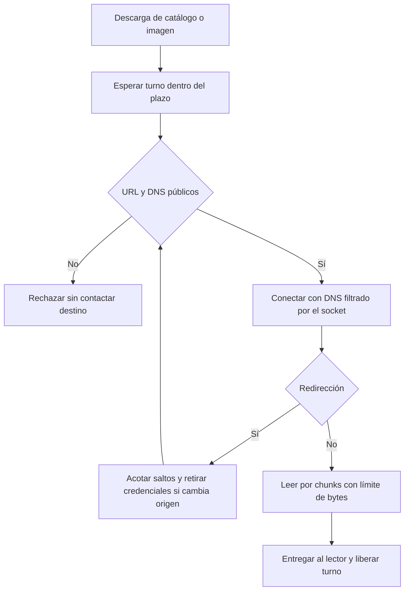

# Correcciones de seguridad y fiabilidad · 0.9.30

**Seguimiento 08/11:** estas correcciones están incluidas en Mac0.9.31 atendiendo la LG con Holy0.9.31 instalado. Cola, pausa, vídeo y un cambio real de servidor tienen comprobaciones físicas; Windows sigue sin actualizar. Los resultados y los fallos externos se detallan en [Despliegue LG08/11](DESPLIEGUE-TV-20261108.md). Las cifras y el cierre operativo descritos abajo corresponden a la revisión del07/11.

Fecha: **2026-11-07**. Continúa la [revisión de calidad y seguridad](REVISION-CALIDAD-SEGURIDAD-20261107.md). Se conservaron los cambios locales anteriores y todas las funciones de catálogo, idioma, servidor, cola, perfiles y reproducción. No se reescribió la máquina de reproducción ni se modificaron firmware, DNS del sistema, arranque, particiones o firewall.

## Qué se corrigió

| Hallazgo | Cambio | Alcance / límite |
| --- | --- | --- |
| SEC-01 | Transporte común `public-fetch.mjs`: comprueba esquema, credenciales y destino en cada salto; la conexión TCP/TLS usa su propia resolución filtrada, rechazando direcciones privadas y respuestas DNS mixtas | Aplicado a lectores de fuentes, resolución/formularios, comprobación de reproductores, sitios, listas/créditos e imágenes. No es un proxy de vídeo |
| SEC-05 | Lectura de cuerpos por chunks con límite, también tras descompresión; 16 MiB por página y 4 MB por imagen; 8 descargas activas y hasta 64 esperando por transporte | Los vídeos siguen viajando directamente a la TV. Tiempo de espera de cada lector conservado; la espera cuenta dentro de su plazo |
| SEC-03 | La URL se analiza dentro del manejo de errores; una dirección inválida responde 400 y un método no soportado responde 405 | La respuesta termina sin depender de la guardia global |
| QUAL-01 | Error de dominio público `queue_full`, HTTP 409, con explicación de los 100 títulos | La UI existente muestra el motivo; todavía permite quitar títulos cuando la cola está llena |
| SEC-04 | Fijación SSH por perfil, con confianza al primer uso y persistencia solo después de autenticación correcta | Rechaza cambio de identidad, archivo dañado y carreras entre identidades. El primer contacto no es una verificación independiente de la TV |
| SEC-02, parcial | Los cambios por navegador exigen que Origin coincida con Host; ya no basta con usar otra IP privada y el mismo puerto | Mantiene app empaquetada, página propia, nombres Windows y puente de relevo. No introduce autenticación general de equipos; clientes nativos en la LAN siguen siendo una confianza abierta |
| Calidad | Sintaxis JS/MJS incluida en test y gate; tests eliminan sus temporales y `validate-engine` usa una salida aislada dentro de la suite | Svelte se comprueba con los builds; no equivale a un sistema completo de tipos o lint |
| Caché | Las respuestas comprimidas conservan tanto `Vary: Origin` como `Vary: Accept-Encoding` | Evita que el tratamiento de compresión borre la variación por origen |

El transporte usa **Undici 7.30.2 fijado**, compatible con la línea Node del proyecto, únicamente en la computadora. No se incluye en las interfaces de TV. No se cambiaron versiones del SDK de LG ni sus dependencias transitivas por la fuerza.

## Compatibilidad que se conserva

- Referer del proveedor, POST de formularios, cookies del mismo origen y múltiples `Set-Cookie`.
- Redirección 307/308 conserva método/cuerpo; 301/302 con POST y 303 cambian a GET como un navegador. Cookies, autorización y CSRF no se reenvían a otro origen.
- DNS IPv4/IPv6 y conexiones reutilizadas, con chequeo de direcciones en el punto de conexión. Una resolución fallida se rechaza en vez de confiar en una segunda respuesta potencialmente diferente.
- Los plazos largos explícitos de listas/créditos no se recortan al plazo de un lector ordinario.
- El puente sigue identificando la app propia de la TV y actualizando su API al equipo activo. Retira Host de una dirección anterior para que la petición use el Host del destino nuevo.
- Los menús Idioma/Servidor, pausa, Atrás, búsqueda, episodios y perfiles siguen sujetos a sus regresiones existentes. No se instaló un IPK nuevo para estos cambios de backend; la UI de 0.9.29 sigue siendo un despliegue aparte pendiente en LG.

## Identidad SSH: cómo funciona y cómo recuperar un cambio real

`connectSession`, común al inspector, reserva y descubrimiento de perfiles, usa `hostHash: sha256` y un verificador. En la primera conexión satisfactoria guarda la huella del servidor después de que el SDK confirme autenticación. En conexiones posteriores exige la misma huella, incluso si la TV cambió de IP. El archivo se crea sin sobrescribir (`wx`), con permisos de usuario en POSIX, y una segunda conexión concurrente no puede reemplazar una huella distinta.

Se guarda fuera del repositorio:

- Mac: `~/.config/HolyLuma/tv-hosts/`.
- Windows: `%LOCALAPPDATA%\HolyLuma\tv-hosts\` del usuario real del servicio.

Contiene nombre del perfil y huella pública, nunca la llave privada. Doctor y la recuperación de perfiles **no borran** esta protección.

Si la TV cambia legítimamente de llave o se sustituye el dispositivo:

1. Comprueba físicamente qué TV/IP aparece en Developer Mode y termina cualquier reproducción antes de cambiar la conexión.
2. Verifica el cambio por una vía de confianza. No borres el pin solo porque lo pide un error de red.
3. Detén el servicio de esa computadora y respalda el archivo de huella. Los archivos JSON de ese directorio muestran `profile` y `fingerprint`.
4. Solo después de verificarlo, elimina explícitamente el pin del perfil usando su huella anterior completa:

```sh
node --input-type=module -e "import { createHostTrust } from './scripts/ssh-host-trust.mjs'; createHostTrust('lg-lab').forget('HUELLA_SHA256_ANTERIOR_DE_64_HEXADECIMALES');"
```

5. Vuelve a vincular con la herramienta oficial si cambió la llave de cliente y reinicia el servicio. La siguiente autenticación satisfactoria registra la identidad nueva.

El ejemplo no funciona con el marcador de posición: la operación exige que la huella indicada coincida con la guardada. No borra biblioteca, gustos, cola ni configuración del SDK. **Límite:** TOFU no elimina el riesgo de suplantación durante el primer contacto. La CLI oficial utilizada por separado para instalar paquetes no hereda automáticamente este verificador del servicio.

## Pruebas y evidencia

Pruebas nuevas:

- `test-public-fetch.mjs`: destinos privados directos, redirecciones, DNS privado/mixto/fallido, carrera DNS entre comprobación y socket real, cookies/POST/Referer, múltiples Set-Cookie, gzip/chunks, límites, timeout y cola de concurrencia/cancelación.
- `test-ssh-host-trust.mjs`: primer uso sin persistir antes de autenticación, pin correcto, cambio de IP, identidad distinta, carreras, archivo dañado, recuperación explícita y wrapper de autenticación fallida/correcta.
- `test-holy-http-errors.mjs`: petición malformada400, método405, error público de cola409, cuerpo413, origen ajeno rechazado, nombre Windows permitido, compresión/CORS e imagen con DNS privado.
- La prueba Svelte de cola ahora comprueba también que el mensaje de capacidad llega a la interfaz. Los tests HTTP con dominios ficticios usan resolución explícita de fixture, sin depender de DNS vivo.

Las pruebas originales de autorización se ajustaron para distinguir el origen propio permitido del origen privado ajeno rechazado; no se eliminaron casos. El cuerpo excesivo ahora tiene el estado preciso 413 en vez de 400. Los parsers de sitios y sus replays existentes no se sustituyeron: cambió su transporte compartido.

Primer gate completo con estas correcciones: sintaxis, suite y tres builds correctos (37 casos documentados/11 fuentes). Gate estable final correcto: **190 archivos JS/MJS, suite completa, 40 casos documentados / 11 fuentes y tres builds**, con huella idéntica antes/después. Evidencia: [correcciones-20261107.json](auditoria/correcciones-20261107.json). Una instalación aislada con `npm ci --ignore-scripts` verificó el lock y la carga JS del SDK y Undici; no acredita una compilación nativa limpia de adblock ni una instalación Windows.

Consulta HTTP real a las once fuentes, sin navegar ni reproducir en la TV: **nueve** resolvieron al menos una muestra. Cuevana no entregó enlace para la muestra elegida; DoramasFlix .beer no entregó muestra de episodio/película. DoramasMP4 resolvió una de dos muestras. Esto es disponibilidad parcial, no un resultado 11/11 ni prueba de vídeo/audio. No se ha demostrado que esos fallos externos sean causados por el cambio. El detalle sanitizado se conserva con la evidencia final.

## Aplicación en la Mac

Después del gate se reinició únicamente el servicio de esta Mac, que al reiniciarse estaba en respaldo. Se comprobó una huella SSH válida con permisos de usuario, perfil sincronizado y salud HTTP200. Al cierre pasó naturalmente a **En espera**, sin ninguna app de TV abierta, con un único supervisor/worker local; el catálogo respondió con1313 títulos. No se solicitó relevo, no se abrió ninguna app ni se instaló paquete en la TV. Windows no se reinició ni se actualizó en esta tarea.



## Qué sigue abierto y por qué

- **Autenticación general de la API LAN (SEC-02):** exigir una credencial nueva a todos los clientes existentes sin un flujo de migración rompería TV/web y equipos de respaldo. Este cambio limita escrituras desde páginas ajenas, pero mantiene explícita la confianza de clientes nativos en la red privada. Diseñar emparejamiento/permisos y migrarlo es trabajo aparte; no se declara solucionado por comparar Origin.
- **Primer contacto SSH:** la fijación evita sustituciones posteriores, no ofrece una comprobación fuera de banda inicial. No se forzó una nueva vinculación del usuario.
- **Dependencias (DEP-01):** el lock conserva diez paquetes con alertas (incluida una crítica transitiva de la CLI). No se aplicó downgrade ni override incompatible del SDK. La dependencia nueva del transporte no añade una alerta al lock consultado. Verificar periódicamente con `npm audit --package-lock-only --json`.
- **Sitios y TV:** los límites y regresiones locales no garantizan todos los servidores ni resuelven por sí solos los cierres nativos ya abiertos. Falta validación física de las funciones nuevas, Windows y un uso prolongado.
- **Tipos/lint y refactor mayor:** se añade sintaxis, pero una reestructuración amplia del puente durante este endurecimiento aumentaría el riesgo de regresiones. Se mantiene como mejora gradual.

No hay una promesa de funcionamiento perfecto ni de ausencia de vulnerabilidades. La versión corrige fronteras reproducibles y explicita las que requieren una migración o evidencia física.
