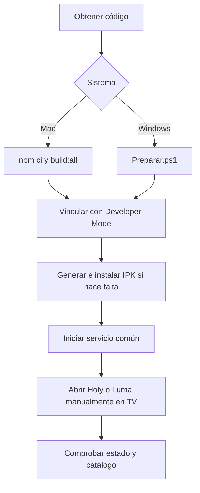

# Instalación, actualización y operación

Revisión: **2026-11-08 · código 0.9.31**. Esta guía describe el código del repositorio; no asegura que los equipos ya ejecuten esa versión. Para el estado del trabajo consulta [SOUL](SOUL.md); para riesgos abiertos, [la revisión de calidad y seguridad](REVISION-CALIDAD-SEGURIDAD-20261107.md).

## Qué se instala y qué necesitas

| Pieza | Dónde | Para qué sirve |
| --- | --- | --- |
| Luma (`com.lgapp.lab`) | LG webOS, paquete IPK | Inicio, buscador, marcadores y navegación |
| Holy (`com.lgapp.holy`) | LG webOS, paquete IPK independiente | Catálogo, búsqueda y reproducción asistida |
| Servicio Node + proyecto | Mac o Windows | Filtrado, catálogo, conexión y guardado |
| Menú Mac / EXE Windows | Computadora, opcional como interfaz | Arrancar, revisar y controlar el servicio |
| Holy web | Navegador en la red local | Catálogo en `http://<computadora>:43190/` |
| Holy Companion | Chrome, Brave o Edge, opcional | Guardar progreso de reproductores externos en el navegador |

Usa una LG con Developer Mode, una cuenta de desarrollador de LG, computadora y TV en la misma red privada, Git y Node/npm. La TV de referencia es una LG 75UR8750PSA con webOS 25; otras versiones de webOS no tienen la misma validación física.

El preparador admite Node **22.13+**, pero la configuración de CI usa **24**. Usa una revisión mantenida de Node 24 para reproducir ese entorno; esta revisión local se ejecutó en Node 22.22.3. `adblock-rs` es nativo: si no hay binario compatible, necesitarás Rust y herramientas C++ de la plataforma. En Mac, compilar el menú Swift requiere las herramientas de desarrollo de Apple; en Windows, el instalador busca el compilador de .NET Framework del sistema.

No uses `npm ci --omit=dev`: hoy el servicio también importa paquetes clasificados como `devDependencies` (`ws`, `adblock-rs`, CLI LG). No copies `node_modules` entre sistemas.

## 1. Descargar el proyecto

```sh
git clone https://github.com/raulisai/LGBrave.git
cd LGBrave
git status --short
```

Al escribir esta guía, 0.9.31 incluye cambios locales todavía sin commit/publicación; clonar `main` no garantiza obtenerlos. Comprueba la versión con `node -p "require('./package.json').version"` y usa los IPK/guías de la revisión que realmente tengas. El backend y el IPK Holy declaran 0.9.31. El backend actualizado está en Mac y Holy en la LG; Windows requiere actualización aparte. Consulta [el despliegue comprobado](DESPLIEGUE-TV-20261108.md).

En una copia existente, conserva los cambios locales antes de actualizar. No borres `.local/`, el perfil webOS ni las llaves para solucionar un fallo de conexión.



## 2. Preparar macOS

Desde la carpeta del proyecto:

```sh
npm ci
npm run build:all
npm run playback:check
```

Para tener el menú nativo, opcional:

```sh
mac/build.sh
open "$HOME/Applications/Luma LG.app"
```

El menú conserva una ruta al proyecto y a Node. Mantén ambos disponibles. Compilar el menú no activa por sí solo el inicio de sesión. Después de vincular, puedes elegirlo explícitamente:

```sh
npm run holy:autostart -- on
npm run holy:autostart -- status
# Para desactivarlo:
npm run holy:autostart -- off
```

## 3. Preparar Windows

Abre **PowerShell normal desde Windows**, fuera de Codex o Claude Desktop de la Tienda. En esas apps el perfil y los procesos pueden quedar dentro de una copia privada. Desde la carpeta del proyecto:

```powershell
powershell.exe -NoProfile -ExecutionPolicy Bypass -File .\windows\Preparar.ps1
```

Este script ya ejecuta `npm ci`, carga el motor nativo, genera los tres builds e instala el EXE con sus comprobaciones. No hace falta repetir `npm run windows:install` al terminar. El `Bypass` corresponde solo a ese proceso; el script no cambia la política permanente.

Abre **Holy y Luma** desde Inicio o `windows\Iniciar Luma.cmd`. El EXE se instala por usuario en `%LOCALAPPDATA%\Programs\HolyLuma\HolyLuma.exe`; sigue necesitando el proyecto y Node. En una primera instalación activa el inicio con Windows, salvo que se instale con la opción correspondiente; el menú permite cambiar esa preferencia. Las actualizaciones conservan la elección previa.

Usa `npm.cmd` cuando PowerShell bloquee `npm.ps1`. No desactives antivirus ni políticas de aplicaciones para forzar un binario rechazado. Si cambias la ruta del proyecto o de Node, reinstala el control con `npm run windows:install` desde la ubicación nueva.

## 4. Vincular cada computadora con la TV

1. En la TV instala y abre **Developer Mode**, inicia sesión con LG y sigue el procedimiento oficial para activarlo. El alta puede requerir reiniciar la TV: hazla fuera de una reproducción.
2. Comprueba la **IP actual** que muestra la TV y activa **Key Server**. Developer Mode tiene una sesión que debe mantenerse vigente; su expiración puede retirar apps de desarrollo.
3. En Windows usa **Vincular TV** en el panel. Solicita IP y passphrase temporal y ejecuta la herramienta oficial. No ejecutes ese paso desde una app de Tienda.
4. En Mac registra el dispositivo y solicita su llave con la CLI local:

```sh
npx --no-install ares-setup-device
npx --no-install ares-novacom --device lg-lab --getkey
npx --no-install ares-device --system-info --device lg-lab
```

En el registro interactivo usa el nombre `lg-lab`, la IP actual, puerto de desarrollo `9922` y usuario `prisoner` para Developer Mode. La passphrase se introduce en el diálogo oficial: no la pongas en un comando, un JSON, un informe ni un commit. La CLI conserva sus llaves fuera del repositorio. Si elegiste otro nombre de perfil, configúralo también en el panel del proyecto.

En Windows existe como alternativa explícita `windows\Link-TV.ps1`; el panel es la ruta preferida. Cambiar la IP en «Configurar» actualiza el perfil oficial. No basta con editar una dirección en una guía. Para varias interfaces o VPN puede ser necesario elegir la dirección de la computadora en el panel.

Referencia: [Developer Mode de LG](https://webostv.developer.lge.com/develop/getting-started/developer-mode-app) y [CLI oficial](https://webostv.developer.lge.com/develop/tools/cli-dev-guide).

## 5. Instalar las interfaces de TV

Genera solo lo que quieras instalar. Estos comandos ejecutan antes la validación completa:

```sh
npm run package:holy
npm run package
```

Comprueba el nombre real del IPK en `artifacts/`. **Las versiones son independientes**: en este árbol Holy declara `0.9.31` y Luma `0.9.2`; el código Node declara `0.9.31`.

Fuera de una sesión de vídeo, instala los paquetes generados:

```sh
npx --no-install ares-install --device lg-lab artifacts/com.lgapp.holy_0.9.31_all.ipk
npx --no-install ares-install --device lg-lab artifacts/com.lgapp.lab_0.9.2_all.ipk
```

Abre la app manualmente desde la TV. Para una apertura deliberada desde la computadora:

```sh
npx --no-install ares-launch --device lg-lab com.lgapp.holy
# O Luma:
npm run tv:launch
```

Instalar o abrir una app puede interrumpir lo que hay en pantalla. El servicio habitual espera pasivamente: no necesita lanzar apps ni ejecutar `ares-inspect`. No modifiques firmware, arranque, particiones ni DNS.

## 6. Iniciar y verificar

```sh
npm run desktop:start
npm run desktop:status
npm run desktop:doctor
```

| Estado | Significado / siguiente paso |
| --- | --- |
| `connected` | Una app compatible está abierta y asistida |
| `waiting` | Conexión disponible; abre Holy o Luma manualmente |
| `standby` | Otra computadora o sesión atiende la TV; es un estado normal |
| `setup` | Falta vincular o actualizar el perfil de TV |
| `offline` | TV no disponible; comprobar red y Developer Mode |
| `conflict` | Puertos o runtime ocupados; detener la copia anterior, no crear otra |
| `unresponsive` / `error` | Consultar Doctor y registros |

Desde un navegador de la misma red abre la dirección que muestra el panel, terminada en `:43190/`. `/holy/` corresponde a la interfaz para TV, la raíz `/` al catálogo web. La dirección amigable `.local` depende del soporte de nombres del dispositivo; si falla, usa la IP actual del estado.

El servicio escucha para la red local. No abras puertos del router ni lo publiques en Internet. La API habitual aún confía en los equipos de la LAN; revisa los [riesgos abiertos](REVISION-CALIDAD-SEGURIDAD-20261107.md). En Windows el firewall opcional tiene una vista previa:

```powershell
powershell.exe -NoProfile -ExecutionPolicy Bypass -File .\windows\Firewall-LAN.ps1 -WhatIf
```

Aplicarlo requiere una decisión explícita y una ventana de administrador. La ruta de Node del script debe coincidir con tu instalación. La vista previa no modifica reglas.

## 7. Dos computadoras, sincronización y complemento

Vincula ambos equipos por separado, instala la misma versión del código e inicia el servicio en ambos. Solo uno obtiene la reserva de la TV; el otro queda en respaldo. **Usar esta computadora para la TV** o `npm run desktop:handoff` solicita el relevo; no lo uses como prueba mientras alguien ve contenido.

```sh
npm run profile:setup
npm run profile:status
```

El primer comando descubre/empareja por SSH sin navegar la TV. Después los equipos intercambian biblioteca cifrada directamente por la LAN, también con la TV apagada. La cola de contenido de 0.9.31 todavía es **local a cada computadora**. Consulta [arquitectura y datos](ARQUITECTURA.md).

Complemento opcional para el progreso de vídeos externos de Holy web:

```sh
npm run browser:companion
```

Carga `artifacts/holy-companion` como extensión descomprimida desde la página de extensiones de Chrome/Brave/Edge. Recarga Holy web y abre el vídeo desde ahí; para otro proveedor, el complemento pide permiso al pulsar su botón. No es necesario para la TV ni para calificar. Si cambia la IP, genera y recarga el complemento. Detalle en [Holy Companion](../browser/holy-companion/README.md).

## 8. Actualizar, respaldar y volver atrás

1. Revisa `git status` y preserva el trabajo local. Obtén cambios con `git fetch origin`; usa `git merge --ff-only origin/main` si tu rama permite ese avance. Si no, resuelve la divergencia conservando tu trabajo.
2. Con el servicio de **esta computadora** detenido y fuera de una reproducción que dependa de él, respalda `.local/holy-library.json`, `.local/browser-settings.json` y `.local/holy-sites.json`, si existen. Guarda el respaldo fuera del repositorio. Son datos privados. Las llaves webOS y la clave de sincronización requieren un respaldo privado separado; no las adjuntes a reportes.
3. Ejecuta `npm ci` si cambió el lock y `npm run playback:check`. El gate ya compila las tres interfaces; no necesitas repetir `build:all` si pasó sobre el mismo código.
4. Para cambios de backend, `npm run desktop:restart`. Para cambios de UI TV, genera e instala el IPK nuevo. Para C#/Swift, recompila el control nativo. Publicar solo el backend no actualiza los recursos dentro del IPK.
5. Comprueba estado, catálogo y perfil en cada equipo. Conserva los IPK anteriores para una reversión deliberada. Reinstalar un IPK previo puede interrumpir la TV; volver atrás en código no implica borrar datos.

Los JSON se guardan localmente; la caché temporal de la TV no sustituye un respaldo. La sincronización tampoco protege de todos los borrados accidentales. No ejecutes simultáneamente `npm run lab` y el servicio común.

Desde 0.9.30 el servicio recuerda la identidad SSH después de la primera autenticación. Si detecta otra huella, no la reemplaza ni la borra con Doctor. Consulta [el procedimiento de recuperación](ENDURECIMIENTO-20261107.md#identidad-ssh-cómo-funciona-y-cómo-recuperar-un-cambio-real) antes de modificar el vínculo.

## Diagnóstico rápido

```sh
npm run desktop:log -- 7
npm run holy:errors
npm run profile:status
npm run desktop:repair
```

`repair` puede aplicar reparaciones: úsalo después del diagnóstico y revisa su resultado. `desktop:stop` apaga el servicio de esta computadora. No hace falta reiniciar una conexión sana porque el otro equipo esté en respaldo.

| Síntoma | Revisar |
| --- | --- |
| No se instala IPK | Perfil correcto, llave, sesión de Developer Mode y archivo generado |
| Catálogo no aparece | IP actual, firewall privado y los builds; consultar Doctor |
| Vídeo web abre otra pestaña | El proveedor exige su propio Referer; es una limitación conocida |
| No aparece Servidor | La versión resuelta no tiene alternativas; tras relevo puede faltar nueva resolución |
| Mi cola cambia al cambiar de equipo | La cola aún no se sincroniza |
| El vídeo se cierra | Registros y minuto guardado; la causa nativa sigue abierta, no reinstalar todo por defecto |

La guía se verificó contra scripts y pruebas de Mac. No se reinstaló desde cero Windows ni la LG durante esta revisión. Las pruebas controladas no acreditan todos los proveedores ni una película completa. Estado detallado: [SOUL](SOUL.md).
